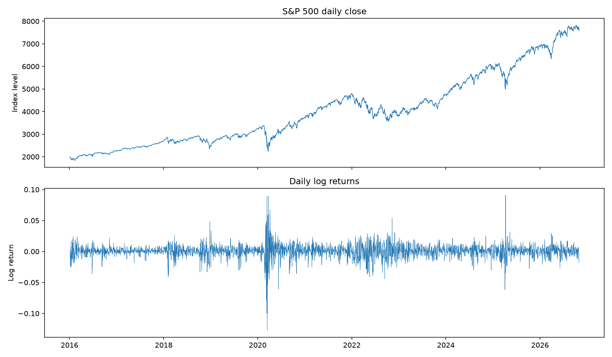
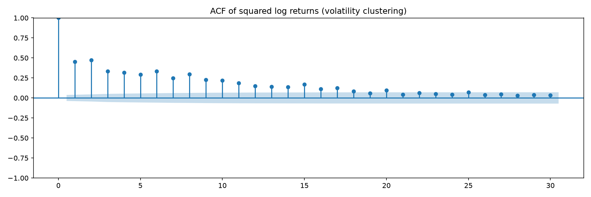
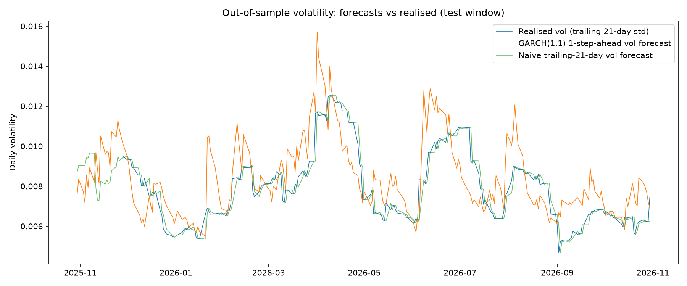

# Volatility Forecasting for the S&P 500: ARIMA vs GARCH(1,1)

## 1. Research question

Daily stock returns are not homoskedastic: large moves follow large moves
and calm periods follow calm periods. This project asks a narrow,
testable question:

> **Does a GARCH(1,1) model produce better one-step-ahead volatility
> forecasts for the S&P 500 than two simple benchmarks — a constant
> variance forecast and a trailing-21-day realised volatility forecast —
> when evaluated strictly out of sample?**

"Better" is measured four ways: RMSE and MAE of variance forecasts
against squared returns, RMSE and MAE of volatility forecasts against
absolute returns, and a Mincer-Zarnowitz (MZ) regression of realised
variance on forecast variance. No trading strategy is built or evaluated
here; this is a forecasting horse race, not a backtest.

**Headline answer.** GARCH(1,1) beats the constant-variance benchmark on
every metric and essentially ties the trailing-21-day naive forecast:
variance RMSE 0.000109 (GARCH) vs 0.000127 (constant) vs 0.000110
(naive). Its MZ slope of 0.37 with R² = 0.014 is the only one of the
three that carries real signal, but all R² values are tiny — which is
expected, because daily squared returns are an extremely noisy proxy for
latent volatility. The honest conclusion is not "GARCH wins" but
"GARCH clearly beats a constant, and is about as good as a trailing
window on this noisy daily criterion, while being far better grounded
in the conditional-variance dynamics documented in Section 5."

## 2. Data

| Item | Value |
|---|---|
| Series | S&P 500 index, ticker `^GSPC` |
| Source | Yahoo Finance via `yfinance` (fallback: Yahoo public chart API) |
| Frequency | Daily closes |
| Sample | 2016-01-04 to 2026-10-30 (2,723 closes) |
| First / last close | 2,012.66 / 7,580.07 |
| Log returns | 2,722 observations, 2016-01-05 to 2026-10-30 |
| Training window | 2016-01-05 to 2025-10-29 (2,470 returns) |
| Test window | 2025-10-30 to 2026-10-30 (252 returns, ~1 trading year) |

The sample deliberately spans several volatility regimes: the calm
2017–2019 period, the March 2020 crash, the 2022 tightening drawdown,
and the 2025–2026 swings. A model fitted only on calm data would flatter
itself; this one does not get that luxury.

### Descriptive statistics (full-sample log returns)

| Statistic | Value |
|---|---|
| Mean (daily) | 0.000487 |
| Std. dev. (daily) | 0.011232 |
| Annualised volatility | 17.83% |
| Minimum | −0.127652 (2020-03-16) |
| Maximum | 0.090895 (2025-04-09) |
| Skewness | −0.687 |
| Excess kurtosis | 16.534 |

Two facts jump out before any modelling. First, the distribution is
strongly left-skewed and fat-tailed: a normal distribution would imply
excess kurtosis of 0, not 16.5. Any model that assumes normal errors
will understate tail risk, a point Section 5 returns to. Second, the
worst day (−12.77%) is far larger in magnitude than the best day
(+9.09%): crashes are sharper than rallies, which is exactly why
volatility forecasting matters for risk rather than for return
prediction.





The ACF of squared returns is positive and slowly decaying out to 30
lags — the textbook signature of volatility clustering. Returns
themselves are close to uncorrelated; their squares are not. That is
the empirical justification for a GARCH model rather than a plain ARIMA
on returns.

## 3. Methodology

### 3.1 Returns and stationarity

Log returns are r_t = ln(P_t / P_{t−1}). Stationarity is tested with
the Augmented Dickey-Fuller (ADF) test, lag length chosen by AIC.

| Series | ADF statistic | p-value | Lags | 1% crit. | 5% crit. |
|---|---|---|---|---|---|
| Close level | 0.5947 | 0.9875 | 9 | −3.4328 | −2.8626 |
| Log returns | −16.8690 | 1.08 × 10⁻²⁹ | 8 | −3.4328 | −2.8626 |

The index level has a unit root (p = 0.99, cannot reject); log returns
are stationary (p ≈ 10⁻²⁹). All subsequent modelling is therefore done
on returns, with integration order d = 0.

### 3.2 ARIMA baseline (mean model)

An ARIMA(p, 0, q) model is fitted to full-sample returns with p, q ∈
{0, …, 3} and the order chosen by AIC. The winner is ARIMA(0, 0, 3):

| Parameter | Estimate |
|---|---|
| const | 0.000483 |
| ma.L1 | −0.1330 |
| ma.L2 | 0.0957 |
| ma.L3 | −0.0512 |
| sigma² | 0.0001226 |
| AIC / BIC | −16778.20 / −16748.65 |

The ARIMA model is a *mean* model: it says almost nothing about
time-varying volatility (its sigma² is a single constant). It is
included as a baseline for the return process and as a reminder that a
good mean fit does not imply a good variance forecast. The variance
benchmarks in the horse race are the constant-variance forecast (the
training-window return variance) and the naive trailing-21-day realised
volatility forecast.

### 3.3 GARCH(1,1)

The model, estimated by maximum likelihood with the `arch` package
(constant mean, normal errors), is:

σ²_t = ω + α·ε²_{t−1} + β·σ²_{t−1},   r_t = μ + ε_t,   ε_t = σ_t·z_t

Estimation uses returns scaled by 100. This is a numerical choice, not
a modelling choice: the `arch` optimiser is unstable on raw daily
returns (scale ~10⁻²) and produced a spurious mean of about −0.10 on
one rolling window. Reported μ and ω below are converted back to
raw-return units (μ / 100, ω / 10000); α, β and persistence are
scale-invariant.

| Parameter | Estimate (training window, n = 2,470) |
|---|---|
| μ | 0.000855 |
| ω | 3.757 × 10⁻⁶ |
| α₁ | 0.1763 |
| β₁ | 0.7953 |
| Persistence (α₁ + β₁) | 0.9716 |
| Shock half-life | 24.09 days |
| Unconditional variance | 0.0001325 |
| Unconditional daily vol / annualised | 0.011509 / 18.27% |

Persistence of 0.97 with a 24-day half-life is the standard S&P 500
finding: volatility shocks decay slowly, so yesterday's variance is
informative about today's, but the process is (just) stationary rather
than integrated. The unconditional annualised volatility implied by the
model (18.27%) is close to the full-sample realised figure (17.83%),
a basic sanity check.

### 3.4 Out-of-sample design (no look-ahead)

The test window is the last 252 trading days. For each test day, the
GARCH model is **refitted on an expanding window containing only data
strictly before that day**, and a one-step-ahead variance forecast is
produced. Baselines use only past data as well (training variance for
the constant forecast; the trailing 21 days for the naive forecast).
No forecast ever sees its own day's return. This matters: many textbook
"forecast evaluations" accidentally refit once and report in-sample fit
as forecasting ability. This one does not.

### 3.5 Scoring

Realised volatility is latent, so it is proxied the standard way:
squared returns proxy realised variance, absolute returns proxy
realised volatility. Both proxies are unbiased but extremely noisy,
which compresses differences between models (see Section 6). The MZ
regression r²_t = a + b·σ̂²_t + u_t is also reported: an unbiased
forecast has a = 0, b = 1; in practice b > 0 with a small R² is the
realistic signature of a useful daily volatility forecast.

## 4. Diagnostics (training-window GARCH fit)

| Test | Statistic | p-value | Reading |
|---|---|---|---|
| Ljung-Box, standardised residuals (lag 10) | 7.352 | 0.692 | No leftover mean autocorrelation |
| Ljung-Box, squared std. residuals (lag 10) | 10.940 | 0.362 | No leftover ARCH effects |
| ARCH-LM (10 lags) | 10.748 | 0.377 | No remaining heteroskedasticity |
| Jarque-Bera, standardised residuals | 1063.19 | 1.35 × 10⁻²³¹ | Normality decisively rejected |

The GARCH(1,1) captures the dynamics: after standardisation, neither
residual autocorrelation nor ARCH effects remain. What it does *not*
capture is the shape of the distribution: standardised residuals still
have skewness −0.778 and excess kurtosis 2.821. A Student-t error
distribution would fit better and is the natural next extension; the
normal version used here understates tail probabilities.

## 5. Results: out-of-sample horse race (252 days)



| Model | RMSE (variance) | MAE (variance) | RMSE (vol) | MAE (vol) |
|---|---|---|---|---|
| **GARCH(1,1)** | **0.000109** | 0.0000713 | 0.005700 | 0.004701 |
| Constant variance | 0.000127 | 0.0001072 | 0.007378 | 0.006577 |
| Naive trailing-21-day | 0.000110 | **0.0000690** | **0.005630** | **0.004565** |

| Model | MZ intercept (p) | MZ slope (p) | MZ R² |
|---|---|---|---|
| **GARCH(1,1)** | 0.0000380 (0.017) | 0.370 (0.059) | **0.0142** |
| Constant variance | — | not identified | — |
| Naive trailing-21-day | 0.0000563 (0.0007) | 0.134 (0.556) | 0.0014 |

(The constant forecast's MZ slope is not identified: the forecast has
zero variance by construction, so the regression collapses.)

Reading the table honestly:

- **vs constant:** GARCH wins everywhere — variance RMSE 14% lower,
  variance MAE 33% lower, vol RMSE 23% lower. A constant variance
  forecast ignores volatility clustering entirely, and it shows.
- **vs naive:** essentially a tie. GARCH wins variance RMSE by 1.2%
  and has a clearly better MZ fit (slope 0.37 vs 0.13, R² ten times
  larger); the naive window wins MAE and both vol metrics by 1–3%.
  These gaps are well within the noise of the squared-return proxy.
- **Test-window context:** realised daily volatility in the test year
  was 0.008077 (12.82% annualised), below the full-sample 17.83% — the
  test year was calmer than the training decade, which included March
  2020 and 2022. Mean absolute daily return in the test window was
  0.006218.

The chart tells the same story visually: GARCH forecasts jump on
volatility events and decay afterwards (persistence at work), while
the naive forecast is a lagged step function that reacts late. The
naive forecast's competitive scores come from the fact that realised
volatility itself is persistent, so "what just happened" is a decent
predictor — GARCH's edge is that it reacts immediately and decays
smoothly rather than dropping off a 21-day cliff.

## 6. Limitations

1. **The realised proxy is mostly noise.** A single squared daily
   return is an unbiased but extremely noisy estimate of that day's
   variance. With 252 test days, genuinely better models can easily
   look tied. Higher-frequency (e.g. 5-minute) realised volatility
   would sharpen the comparison dramatically; it was out of scope for
   daily data.
2. **Normal errors understate tails.** Jarque-Bera rejects normality
   decisively (p ≈ 10⁻²³¹). For risk applications (VaR, expected
   shortfall), refit with Student-t errors before trusting any tail
   number from this model.
3. **One index, one regime mix.** Results are for the S&P 500 over
   2016–2026. Nothing here says the same ranking holds for single
   stocks, other indices, or a crisis-only window. The test year was
   calmer than the training period; a stress-period evaluation could
   rank the models differently.
4. **Parameter stability is assumed, not tested.** The rolling fits
   show persistence near 0.97 throughout, but no formal break test
   (e.g. around March 2020 or 2022) was run. Regime-switching or
   asymmetric (GJR/TGARCH) extensions are natural next steps, given
   the negative return skewness.
5. **No trading conclusion follows.** A better volatility forecast is
   not a profitable strategy. Transaction costs, borrow, slippage,
   and the gap between forecast variance and tradeable instruments
   are all outside this project.
6. **Data revisions and corporate actions.** Index closes are used as
   published by Yahoo Finance; dividend treatment is irrelevant for an
   index level, but any Yahoo data error would flow straight into the
   results. The downloaded CSV is saved in `data/` so every number can
   be recomputed.

## 7. Reproducibility

```bash
pip install -r requirements.txt
python3 run_all.py
```

This regenerates `data/sp500_daily.csv`, `output/results.json`,
`output/garch_forecasts.csv`, `output/naive_forecasts.csv` and all
three charts. Every number in this report is read from
`output/results.json` after a clean run; no number was typed from
another source. The clean-run verification reproduced the headline
figures exactly (GARCH variance RMSE 0.000109, α₁ = 0.1763,
β₁ = 0.7953).

## References

- Bollerslev, T. (1986). Generalized autoregressive conditional
  heteroskedasticity. *Journal of Econometrics*, 31(3), 307–327.
- Box, G. E. P., Jenkins, G. M., & Reinsel, G. C. (2008). *Time
  Series Analysis: Forecasting and Control* (4th ed.). Wiley.
- Dickey, D. A., & Fuller, W. A. (1979). Distribution of the
  estimators for autoregressive time series with a unit root. *Journal
  of the American Statistical Association*, 74(366), 427–431.
- Engle, R. F. (1982). Autoregressive conditional heteroskedasticity
  with estimates of the variance of United Kingdom inflation.
  *Econometrica*, 50(4), 987–1007.
- Mincer, J., & Zarnowitz, V. (1969). The evaluation of economic
  forecasts. In *Economic Forecasts and Expectations* (pp. 1–46). NBER.
